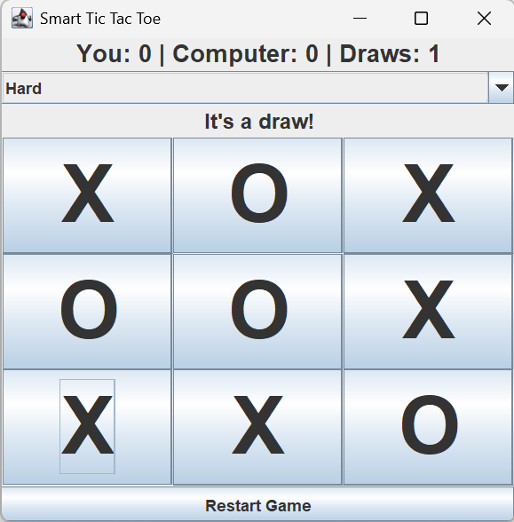

# Smart Tic Tac Toe — Java AI Game

A desktop Tic Tac Toe application developed in Java
using Swing and object-oriented programming.

The application allows users to play against a
computer opponent with two difficulty levels.

## Screenshot

## Features

- Interactive 3×3 graphical game board
- Human vs Computer gameplay
- Easy and Hard AI difficulty modes
- Minimax algorithm for intelligent decision-making
- Automatic winner and draw detection
- Restart functionality
- Session-based score tracking
- Automated unit testing with JUnit 5

## Technologies

- Java
- Java Swing
- Object-Oriented Programming
- Minimax Algorithm
- JUnit 5
- Eclipse IDE

## How the AI Works

### Easy Mode
The computer selects the first available square.

### Hard Mode
The computer uses the Minimax algorithm to evaluate
possible future moves.

The algorithm assigns scores to outcomes:

- Computer victory: positive score
- Human victory: negative score
- Draw: zero

The AI uses recursion to explore possible moves and
select an optimal outcome.

Search depth is included to prioritize faster wins.

## Project Structure

- GameBoard.java — Board logic and game rules
- AIPlayer.java — AI decision-making algorithms
- GameGUI.java — Swing graphical interface
- Main.java — Application entry point
- GameBoardTest.java — Game logic tests
- AIPlayerTest.java — AI decision-making tests

## Running the Application

1. Install a compatible Java Development Kit (JDK).
2. Open the project in Eclipse.
3. Ensure the project has no compilation errors.
4. Run Main.java as a Java Application.

## Testing

JUnit 5 is used to test:

- Valid and invalid moves
- Occupied positions
- Winner detection
- Draw detection
- AI winning moves
- AI defensive moves
- Board preservation during AI evaluation

## Future Improvements

- Computer vision-based interaction
- Persistent score storage
- More advanced interface customization

## Author

Parth Madan
Computer Science Student
York University
